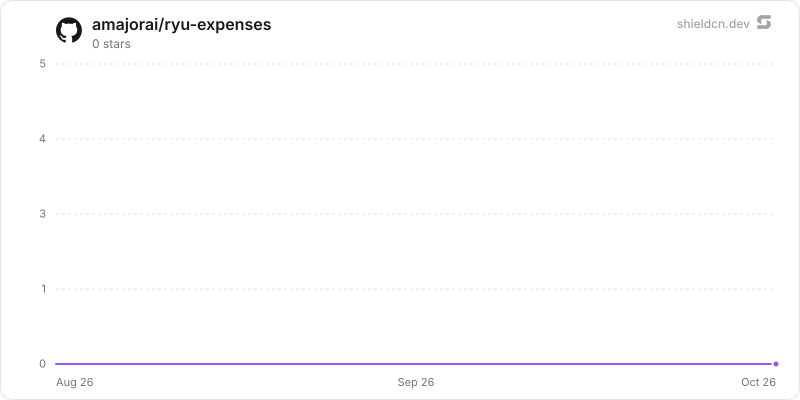

<div align="center">

# expenses

</div>

A local-first expense ledger with an agent, Companion, MCP tools, and one SQLite source of truth.

> **The public home of `ryu-expenses`.** Source, builds, and releases live here —
> binaries for every platform are attached to each release.
>
> This tree is generated from the Ryu monorepo, so commits pushed here
> directly are replaced on the next sync. **Pull requests are welcome** —
> open them here and they are ported into the monorepo, then flow back out.
> Ryu as a whole: https://github.com/amajorai/ryu

## Install

**App:** [Install](ryu://apps/com.ryu.expenses) (opens the Ryu desktop app and asks you to confirm)

**CLI:**

```bash
ryu apps add com.ryu.expenses
```

**From source:**

```bash
cargo build --release --manifest-path backend/Cargo.toml
```

Prebuilt binaries for every platform are attached to [each release](https://github.com/amajorai/ryu/releases).

## License

Apache-2.0 — see [LICENSE](./LICENSE).

## Use it two ways

- Install the **Expenses** app to get the Expense Tracker agent runnable and the
  visual companion together.
- Install the standalone **Expense Tracker** Marketplace agent first, then add
  the Expenses app when you want the visual view. The agent template declares
  `@ryu/expenses` as its required data provider; it does not copy or create a
  second ledger.

## Agent tools

The sidecar's MCP server is registered as `expenses` and exposes:

- `expenses.list`
- `expenses.summary`
- `expenses.add`
- `expenses.update`
- `expenses.delete`

The companion calls the same store through the generic own-app bridge. It never
receives a node token or makes a direct network request.

## Data

Money is stored as positive integer minor units, dates are calendar strings, and
summaries never add unlike currencies. The node owns the SQLite database. This
app does not connect to banks, convert exchange rates, or provide financial or
tax advice.

## Local sidecar

The process is `ryu-expenses`. Core supplies its resolved data directory and
sidecar port when the app is enabled. For an isolated standalone development
run, use `RYU_PROFILE=dev RYU_KEYCHAIN=off RYU_DIR=/tmp/ryu-expenses-dev`.

## At rest

`expenses.db` seals `merchant`, `account`, `note` and `amount_minor` per value (`encb:v1:`,
store `expenses.db`, bound to the column and the expense id) under the `@ryu/expenses` plugin
subkey Core delivers to the sidecar (`crypto:seal` in the sidecar's `host_api.grants`).
`spent_on`, `category` and `currency` stay plaintext: they are the SQL filters and the sort key.
Totals are summed in Rust after opening. Legacy plaintext rows are sealed when the store opens
(resumable, idempotent), then the WAL is truncated and freed pages are zeroed (`secure_delete`
is on for every connection). A sealed column that still holds plaintext (left by an older
keyless writer) is walked again at the next open. An expense that does not open is left out of
lists and summaries and counted (`/health` `sealing.unreadable_rows`). Key states
(`backend/src/seal_keys.rs`):

- **Compat mode**: under an older Core that delivers no key, a never-sealed store keeps working
  in plaintext and `/health` reports `sealing.state = "compat"` ("waiting for a Ryu update").
  Every compat write re-checks the store inside its write transaction and is refused once a
  keyed process has sealed it.
- **No key or another key for a sealed store**: `sealing.state = "unhealthy"`, writes are
  refused and the data is kept.
- **Standalone** (no `RYU_PLUGIN_DATA_DIR`): `RYU_MASTER_KEY` if set, else a generated root in
  `<plugin data dir>/secrets/standalone-root.key` (0600) whose key check value is pinned.
- **`ryu-expenses mcp`** gets no key (Core delivers keys to sidecars only). It goes through the
  running sidecar instead (`ryu_sidecar_runtime::handoff`, re-exported as
  `src/sidecar_link.rs`): at start the sidecar writes
  `<plugin data dir>/secrets/sidecar-handoff.json` (0600) with its loopback port and a random
  token minted for that run (never the Core ext token; replaced at every start, removed on
  shutdown). That token opens only `/api/expenses/expenses[/...]` and `/api/expenses/summary`.
  When no sidecar answers (the sidecar is lazy and stops when idle), the MCP server opens the
  store itself and never generates a standalone root: against a sealed store it refuses and
  asks to open the app first.

The standalone satellite mirror builds `ryu-crypto` from crates.io at the declared version, so
the release train that ships this must publish `ryu-crypto` first (already ordered before app
backends in `tools/publish-crates.sh`).

## Star History

<a href="https://github.com/amajorai/ryu-expenses/stargazers">
  <picture>
    <source media="(prefers-color-scheme: dark)" srcset="./.github/shieldcn/star-chart-dark.svg" />
    
  </picture>
</a>
